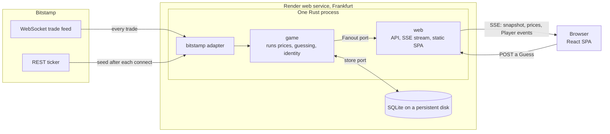

# Hoof & Claw

A web game: guess whether the price of Bitcoin in US dollars (BTC/USD) is higher or lower one minute from now.

Live at **https://hoof-and-claw.miwurster.com**.

## The rules

- A Player sees their Score and the latest BTC/USD price at all times.
- A Player guesses Up or Down and can't place another Guess until the Open guess resolves.
- A Guess resolves on the first price change at least 60 seconds after it was placed.
  A correct Guess adds one point, a wrong one takes one away.
- New Players start at Score 0.
  A Player can close the browser, come back, and carry on with the same Score.

The domain terms (Player, Guess, Start price, End price, Outcome, Price delayed) are defined in `GLOSSARY.md`.

## Architecture at a glance



- The whole backend is one always-on Rust process.
  It serves the React app, the JSON API and the event stream from one origin.
- The process keeps one WebSocket connection to Bitstamp and reads every BTC/USD trade.
- On every trade it resolves the Guesses that are due, saves the Outcomes and Scores to SQLite, and only then tells the browsers.
- Each browser tab opens one server-sent events (SSE) stream.
  The stream starts with a snapshot of everything the tab shows.
  After that it carries price changes, at most one a second, and the Player's own events.
- A Guess resolves on the server even when no browser is open.

## Key decisions and why

| Decision | Why | What we didn't do |
| --- | --- | --- |
| One always-on process holds the price feed, the game and the HTTP server. | A live feed and timely resolution need something that is always running; one process is the simplest design that meets every rule. | Serverless functions with polling and a scheduled call per Guess, which resolve up to two minutes late. |
| The server is the only authority on prices, time and Outcomes. | The client never sends a price or a timestamp, and one clock decides the 60-second boundary, so no Player can bend an Outcome. | Trusting the browser's clock or the trade's exchange timestamp. |
| The End price is the first price the server receives at least 60 s after the Guess that differs from the Start price. | It follows the rule "the price changed and 60 seconds passed" literally and is easy to check. | Backfilling a historical price after an outage. |
| Prices come from Bitstamp. | Its terms allow showing its data to Players; Coinbase's and Kraken's forbid it without written consent. | Coinbase or Kraken, which trade more often. |
| Every trade is processed; while the feed is down the price is "Price delayed" and new Guesses are refused. | A Guess must start from a price the server knows to be current. Open guesses wait for the feed to come back instead of being voided. | Sampling the price on a timer, or voiding Guesses after an outage. |
| One SSE stream per tab, opening with a snapshot. | The server only pushes, SSE carries the identity cookie, and a reconnect rebuilds the whole state from the snapshot, so nothing is lost or applied twice. | WebSockets, polling, or replaying missed events. |
| Save first, publish second. | A Player never sees an Outcome that a failed save then loses. | Publishing before the write is durable. |
| SQLite on a disk, in WAL mode, with one writing connection. | One instance needs no database server; SQLite handles thousands of writes a second, far beyond the demo. | Managed Postgres, which doubles the cost and adds a network hop. |
| Rust (axum, tokio, sqlx), with crates cut by area of the game and ports and adapters. | Agents write the code, so the compiler and crate boundaries enforce the rules a human reviewer would otherwise check. The price source, store, clock, identity and event delivery are swappable without touching the game rules. | TypeScript on the server, or layers like `models/` and `services/`. |
| Prices are integer cents. | Comparing with the Start price is the only arithmetic, and integers compare exactly. | Floating point, or a decimal library. |
| An anonymous random token in an `HttpOnly` cookie identifies a Player. | No sign-up for a demo, and JavaScript never sees the token. Sign-in methods can attach to an existing Player later without merging Scores. | Accounts and login, or a token in `localStorage`. |
| A client-rendered React SPA, served by the game server. | One screen with a live stream gains nothing from server rendering, and one origin keeps the cookie simple. | A second server for rendering pages. |

## Known trade-offs

- **Every deploy takes the game down for a few seconds**, and a platform maintenance window, about once a quarter, for a few minutes.
  On shutdown, the server refuses new Guesses, finishes running requests and closes the streams.
  Meanwhile the browser shows the last price as "Price delayed" with Up and Down disabled, reconnects after a random delay, and rebuilds its state from the snapshot.
  Open guesses survive, because the server saves a Guess before it acknowledges it.
  A Guess that falls due during the downtime resolves on the first changed price after the restart, a few seconds later than it otherwise would.
- **There is no database backup.**
  Losing the disk resets every Score to 0, which is acceptable for a three-month demo.
- **There is one price source.**
  If Bitstamp is unreachable, the game shows "Price delayed" and refuses new Guesses until the feed returns.
- **There is one instance, with no redundancy.**
  A Render service with a disk runs exactly one instance, which also means price ingestion and resolution need no coordination.
- **Abuse protection is per-IP rate limiting only.**
  The server limits how often an IP places Guesses and gets new identity cookies, and allows about ten concurrent streams per IP.

## Scaling options

### Why the demo runs on Render

We decided to spend no more than 10 EUR a month on the demo for now.
That budget, not a technical limit, decides where it runs today.
AWS could be the option in the long run, and other clouds such as Google Cloud are options too.
Besides the budget, the demo must not show a cold start, and it must resolve Guesses with no browser open.

- **Render runs one always-on process with a disk in Frankfurt for about 7.25 USD a month.**
  That process meets every rule of the game.
- **An always-on process on AWS is over budget.**
  App Runner costs about 14 USD a month, and ECS Fargate needs a load balancer that pushes it past 20 USD.
- **Serverless AWS would work for the demo, and it would cost less.**
  A Rust Lambda can hold the Bitstamp feed in overlapping 15-minute runs and resolve due Guesses on every trade, within the free tier.
  It gives up three things.
  Accepting a Guess and receiving prices happen on different machines, so two clocks decide the 60-second rule.
  Browsers poll a cached price instead of receiving a push, so a price can be about two seconds old.
  And a crashed run can leave the feed down for minutes.
  It also gets expensive fast: push services charge about 1 USD per million messages, so one price a second to 1,000 Players costs about 2,600 USD a month.

The game rules contain no hosting code.
The price source, the store, the clock, identity and event delivery sit behind ports, so a move to another platform replaces adapters, not the game.

### Load model

Each concurrent Player places about one Guess a minute, which is close to the maximum because a Guess stays open for at least 60 seconds.
That is one Guess a second per 60 Players and about 2.5 writes per Guess.
Every Player holds one stream that receives at most one price a second, about 150 bytes per message.

| Concurrent Players | Guesses a second | Writes a second | SSE connections | Outbound traffic, around the clock |
| --- | --- | --- | --- | --- |
| Tens (the demo) | < 1 | ~1 | tens | ~1.3 GB a month at 20 viewers, 4 hours a day |
| 1,000 | ~17 | ~40 | 1,000 | ~150 KB/s, ~390 GB a month |
| 10,000 | ~170 | ~420 | 10,000 | ~1.5 MB/s, ~4 TB a month |

The price feed doesn't grow with the number of Players, because the server needs one connection to Bitstamp at every scale.

### Where the limits are

We measured a throwaway prototype of this design on a laptop with two worker threads, one run each.
The numbers are rough sizes, not guarantees.

| What | Measured |
| --- | --- |
| Memory per open stream | about 32 KB, so about 320 MB at 10,000 streams |
| CPU to push one price a second | about 0.2 of a core at 10,000 streams |
| Time until the last stream has a new price | about 22 ms at 1,000 streams, about 99 ms at 10,000 |
| SQLite, resolutions saved in batches | millions of rows a second, against about 420 writes a second needed at 10,000 Players |

From these, we estimate that one process with 4 CPUs and 8 GB carries 30,000 to 50,000 streams.
The worst single moment is a burst.
After a quiet market, one trade can resolve thousands of due Guesses at once, and the server saves them in batches.

So capacity is not what forces the first change.
Two other things come first:

- **Availability.** One instance means every deploy and every platform maintenance window takes the game down.
- **Traffic cost.** Outbound traffic grows with every viewer.
  Render charges 0.15 USD per GB beyond the included 5 GB, about 58 USD a month at 1,000 viewers around the clock and about 600 USD at 10,000.
  The big clouds charge less per GB, about 0.09 USD on AWS.

### Step 1: deploys without downtime

The trigger is availability, not load.
This step comes when a few seconds of downtime per deploy are no longer acceptable.

- Render runs zero-downtime deploys only for a service without a disk.
  So SQLite on the disk gives way to managed Postgres behind the same store port.
  The new adapter must pass the same store test suite the SQLite adapter passes.
- During a deploy, the old and the new process run side by side for a moment.
  Only one of them may hold the price feed and resolve Guesses, so the process that holds a Postgres advisory lock is the leader, and the other waits for the lock.
- Clients notice nothing beyond a reconnect, because every stream opens with a snapshot.

### Step 2: more than one instance

The trigger is about 5,000 sustained concurrent Players, or the first time a single instance failing is not acceptable, whichever comes first.
After step 1, this is a small change:

- **One leader, many stream servers.** The leader holds the Bitstamp feed, stamps each price with its receipt time and resolves Guesses.
  Every instance serves the API and holds SSE streams.
- **Events between instances.** The leader publishes prices and Player events through Postgres `LISTEN/NOTIFY`.
  Because a notification can be lost, the leader also queries for due Guesses at a regular interval.
- **One clock.** A Guess may arrive at any instance, but its placement time and Start price come from the leader, so one clock still decides the 60-second rule.
- **No sticky sessions.** Any instance can serve any tab, because every stream opens with a snapshot of the Player's state.
  Render's load balancer offers no sticky sessions, and the game doesn't need them.
- **Draining.** An instance that shuts down closes its streams spread over the drain window, and clients reconnect after a random delay, so a deploy doesn't cause a reconnect storm.

### Where to run it

The same building blocks exist on each platform.

| Building block | Render | AWS | Google Cloud |
| --- | --- | --- | --- |
| Always-on Rust process | Web service | ECS Fargate task behind an Application Load Balancer | Compute Engine or GKE |
| Managed Postgres | Render Postgres | RDS for PostgreSQL | Cloud SQL |
| Leader election and events between instances | Postgres advisory lock and `LISTEN/NOTIFY` | the same | the same |
| Pub/sub at larger scale | Render Key Value | ElastiCache | Memorystore |
| Price delivery to browsers | the game server's SSE stream | the same, or AppSync Events or IoT Core at about 1 USD per million messages | the same |

Render can carry the game well past the demo, because a web service without a disk runs up to 100 instances.
Google Cloud Run is a poor fit for this game.
An instance holds at most 1,000 streams, every stream ends after 60 minutes, and even a minimum instance can be shut down at any time.

Reasons to move from Render to a larger cloud:

- traffic cost per GB becomes a noticeable part of the bill;
- we need failover across availability zones or managed services Render doesn't offer;
- the organisation already runs on one cloud and wants the game there.

### Beyond 10,000 Players

Beyond this, the design needs its own work.
The open questions are:

- how one ingesting process, with a standby, hands prices to many stateless stream servers;
- how resolution is partitioned by Player while every partition resolves against the same prices;
- how to absorb the burst when tens of thousands of Guesses fall due on one trade after a quiet market.

The game rules stay the same at every step.

## Why SQL, and when NoSQL

The game's data fits a relational store well.

- **One Open guess per Player** is one partial unique index.
- **Resolving a Guess** with its Score change is one conditional `UPDATE` in a transaction that only touches a Guess that is still open, so a retry can't resolve it twice.
- **Rebuilding the index of due Guesses** at start-up is one query by status and due time.
- **A future leaderboard** is an index on Score, and **a future sign-in identity** stays unique through one unique index.
- **Every store adapter passes one shared test suite**, and SQLite and Postgres both report real transaction conflicts, so the suite catches races.

SQLite is enough while one process is enough, up to about 10,000 Players.
Its limit is that it lives on one host, not its write speed.
Writes must be batched, though.
With one transaction and one disk flush per placed Guess, a laptop managed only about 256 Guesses a second, while batches of resolutions ran at 19,000 to 87,000 a second.

Postgres takes over from step 1 on.
A local Postgres on a laptop ran about 28,000 complete Guesses a second, so we estimate that one primary carries 10,000 to well over 100,000 Players; that benchmark is an upper bound, not a measurement on a cloud database.
Read replicas don't help, because every read is a lookup of one Player.
At that size, the table of resolved Guesses needs monthly partitions.

NoSQL doesn't pay off for this game below about a million Players.
DynamoDB can do the core operations as conditional writes, but the start-up rebuild and a leaderboard need an index every Player writes to, and one partition takes at most 1,000 writes a second.
It becomes a fair choice in two cases: sharding by Player at around a million Players, or a move to serverless hosting, where there is no process to hold state.
We would not use these as the primary store:

- Redis can lose up to a second of acknowledged writes; it fits as a leaderboard next to SQL.
- Firestore is the most expensive option and hits its write limit on indexed timestamps at about 30,000 Players.
- Cassandra and ScyllaDB turn every conditional write into a consensus round.

## Quality without line-by-line review

Agents write the code.
Quality comes from guardrails that run in one Green gate, `mise run gate`, locally and in CI:

- **Unit and domain tests.** They are written test-first, with property-based tests for the game rules.
- **An acceptance suite.** It runs on Playwright and TypeScript, in four layers: test cases in domain language, a DSL, protocol drivers, and the system under test.
  Every case runs twice, through the browser UI and through the HTTP API.
  A controllable clock and price source make 60-second rules testable without waiting:

  ```ts
  await priceSource.sends("64,000.00");
  await alice.guesses("Up");
  await clock.advance(seconds(60));
  await priceSource.sends("64,000.01");
  await alice.should.seeOutcome("Correct");
  await alice.should.haveScore(1);
  ```

- **A performance layer.** It drives 200 Players against a local server, with budgets for price fan-out, placing a Guess, a resolution burst, the snapshot and memory.
  It catches regressions; it doesn't prove capacity in production.
- **Architecture tests.** They fail on a forbidden dependency between crates or packages.
- **Strict linters.** Clippy runs with pedantic lints and forbids `unwrap` and `unsafe`; `cargo-deny`, `cargo-shear` and Oxlint for TypeScript run alongside.
- **A generated API contract.** `ts-rs` generates the TypeScript types from the Rust wire types, so a mismatch between frontend and server fails the build.

Only test builds compile in the test controls, and a check in the gate proves the release build doesn't contain them.

## Run, test, deploy

All tasks run through [mise](https://mise.jdx.dev/), which also pins the tool versions.

| Task | Command |
| --- | --- |
| Run every check, as CI does | `mise run gate` |
| Start a local server with test controls on an empty database | `PORT=<port> DATABASE_PATH=<file> mise run launch` |
| Run the acceptance suite | `pnpm --filter acceptance test` |
| Run the performance cases | `mise run perf` |
| Release a green `main` commit | `mise run release [sha]` |
| Smoke-test the deployed service | `pnpm smoke` |

CI (GitHub Actions) runs only the Green gate, on every push to `main` and every pull request.
A Release fast-forwards the `release` branch to a `main` commit whose gate passed; Render builds the Docker image from that branch and deploys it.
Rollback uses Render's dashboard.
Terraform describes the Render service.

## Going deeper

None of these is needed to understand this README:
`ARCHITECTURE.md` (where code goes and which test enforces each rule), `CODING_STANDARDS.md`, `GLOSSARY.md`, and the decision records in `docs/adr/`.
